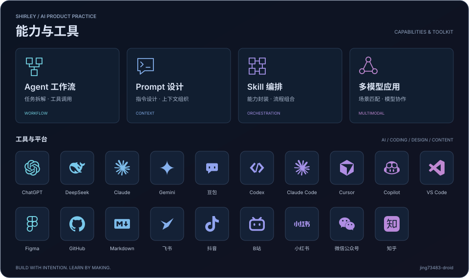

# 你好，我是 Shirley 👋

<h3 align="center">About Me</h3>

I'm Shirley Huang, focused on AI product design and hands-on experimentation. 
Through independent projects, I explore user needs and turn ideas into products 
that people can try and validate—with documentation, prototypes, and tools. 
Feel free to connect with me on Xiaohongshu or explore my project documentation.

<a href="https://www.xiaohongshu.com/user/profile/57b338e35e87e726f7389f02">📕 Xiaohongshu</a> ·
<a href="https://github.com/jing73483-droid?tab=repositories">💻 Projects &amp; Documentation</a>

---

---

## ✍️ 写作与分享

我也在公众号分享 AI 相关内容，以下是近期文章入口。

[阅读文章 01](https://mp.weixin.qq.com/s/TZCoeKeb1HqMlxSev869jA) · [阅读文章 02](https://mp.weixin.qq.com/s/9LPGefWKB5H0EY6QUeMYeQ) · [阅读文章 03](https://mp.weixin.qq.com/s/eaZ_efwg_hVMNGbgHlXpwA)
