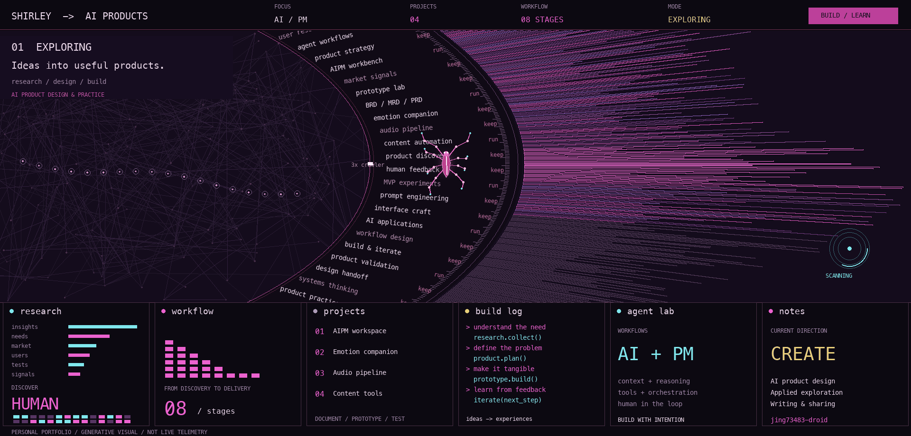

# 你好，我是 Shirley 👋

专注 AI 产品设计与应用实践，具备需求分析、产品规划与原型设计能力。  
结合 Agent 工作流与多模型能力，将用户需求转化为可执行的产品方案。  
覆盖需求研究、MVP 定义、PRD 编写及开发交接，注重产品验证与迭代。

📕 [小红书](https://www.xiaohongshu.com/user/profile/57b338e35e87e726f7389f02) · 💻 [GitHub 项目](https://github.com/jing73483-droid?tab=repositories)

---

## ⭐ 精选项目

### 🧭 AIPM 工作台 · 产品经理工作流程设计

面向 AI 产品经理，将需求洞察、市场与用户研究、BRD、立项、PRD、设计交接、开发测试交接和上线复盘组织为八阶段工作流程。

围绕各阶段的工作任务，集成竞品分析、需求文档和设计规范等 PM Skill，让研究与方案设计可以在同一桌面工作台中推进。这个项目重点展示产品流程拆解、任务组织，以及从需求到交付的衔接设计。

基于 DeepSeek Harness 定制，个人实践集中在 AIPM 工作流程、Skill 集成与桌面入口，保留上游框架归属。

[查看项目](https://github.com/jing73483-droid/aipm-workbench) · [工作流程与功能说明](https://github.com/jing73483-droid/aipm-workbench/blob/main/AIPM.md)

### 🌙 AI 情绪陪伴产品

面向泰语情绪承压用户，以情绪输入、陪伴解读和温和行动建议为核心体验。从 TikTok 泰语评论中的需求线索出发，整理 BRD、MRD 和十个模块的 PRD。

文档重点讨论如何收缩 MVP，以及通过保存、追问、等待名单和付费意愿点击验证需求。现阶段保留样本局限，付费意愿指标属于验证设计。

[查看项目](https://github.com/jing73483-droid/zhanbubu) · [BRD](https://github.com/jing73483-droid/zhanbubu/blob/main/BRD.md) · [MRD](https://github.com/jing73483-droid/zhanbubu/blob/main/MRD.md) · [PRD](https://github.com/jing73483-droid/zhanbubu/tree/main/PRD)

### 🎙️ 漫剧音频工作台

围绕漫剧制作中的配音、配乐与字幕，设计可离线打开的 B 端交互原型。将角色声线、情绪匹配、时间轴调整和混音导出组织成一套操作流程。

可以查看前端交互说明与后端接口契约。当前原型包含模拟生成，真实模型生成需要接入后端适配器。

[查看项目与原型说明](https://github.com/jing73483-droid/drama-audio-pipeline) · [后端接口设计](https://github.com/jing73483-droid/drama-audio-pipeline/blob/main/AUDIO_PIPELINE_BACKEND.md)

### 📝 AI 内容自动化

围绕 AI 资讯图文制作，整理内容采集、配图生成与发布流程，并提供项目说明、快速开始和 API 文档。

这份案例适合了解如何把重复的内容操作拆成可执行步骤，以及如何通过说明文档支持使用和交接。

[查看项目](https://github.com/jing73483-droid/xiaohongshu-auto) · [快速开始](https://github.com/jing73483-droid/xiaohongshu-auto/blob/main/QUICKSTART.md) · [API 文档](https://github.com/jing73483-droid/xiaohongshu-auto/blob/main/API_DOCS.md)

---

## ✍️ 写作与分享

我也在公众号分享 AI 相关内容，以下是近期文章入口。

[阅读文章 01](https://mp.weixin.qq.com/s/TZCoeKeb1HqMlxSev869jA) · [阅读文章 02](https://mp.weixin.qq.com/s/9LPGefWKB5H0EY6QUeMYeQ) · [阅读文章 03](https://mp.weixin.qq.com/s/eaZ_efwg_hVMNGbgHlXpwA)

---

## 关于我

黄璟 Shirley，专注 AI 产品设计与应用实践。  
通过独立项目探索用户需求，用文档、原型和工具把产品方案推进到可体验、可验证的阶段。  
欢迎通过小红书交流，也欢迎查看项目文档。
